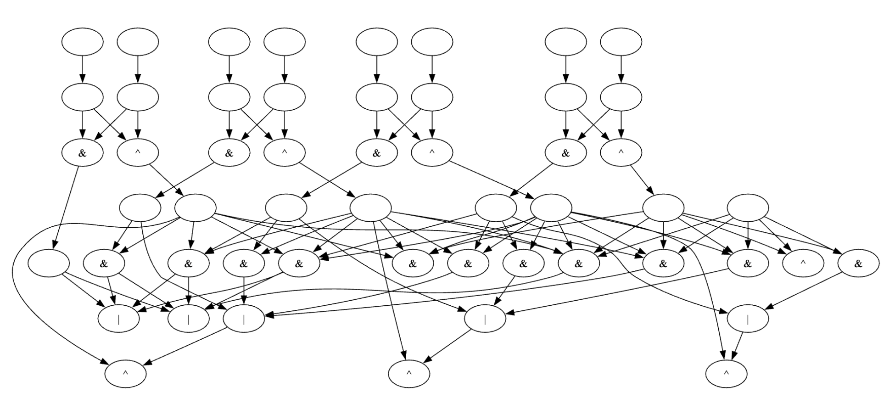

# Open Digraphs & Boolean Circuits Library

A Python library implementing **Open Directed Multigraphs** (`open_digraph`) and **Boolean Circuits** (`bool_circ`), featuring graph composition, algorithmic analysis, Graphviz visualization, logical formula parsing, arithmetic circuits (Ripple-Carry & Carry-Lookahead Adders), Hamming error-correcting codes, and algebraic circuit simplification and optimization.

---

## Repository Structure

```text
├── images/
│   ├── cla_adder4.png                # Visual rendering of the 4-bit Carry-Lookahead Adder
│   ├── circuit_before_simplif.png    # Boolean circuit before algebraic simplification
│   └── circuit_after_simplif.png     # Same circuit after `simplifier_optimiser_complet()`
├── modules/
│   ├── open_digraph.py               # Core `node` and `open_digraph` classes (structure, manipulation, validation)
│   ├── open_digraph_mx.py            # Mixins: Matrix conversions, Graphviz DOT/PDF export, compositions & algorithms
│   └── bool_circ.py                  # `bool_circ` subclass: Logic gates, adders, Hamming codes, evaluation & optimization
└── README.md
```

---

## Visual Examples

All circuit diagrams below are automatically generated from the Python data structures using the Graphviz `.save_as_pdf()` export feature.

### 1. Algebraic Circuit Simplification & Optimization
Applying `simplifier_optimiser_complet()` reduces gate count and circuit depth through rewriting rules (involution, associativity, `NOT`-pushing, idempotence, and dead-node pruning) while preserving logical equivalence:

| Before Simplification | After `simplifier_optimiser_complet()` |
| :---: | :---: |
|  |  |

### 2. Constant-Depth 4-Bit Carry-Lookahead Adder (`cla_adder4`)
Unlike ripple-carry adders whose depth grows linearly with bit-width, the CLA architecture computes carry propagate ($P_i$) and generate ($G_i$) signals in parallel using $n$-ary gates:

<p align="center">
  
</p>

---

## Key Features

### 1. Open Directed Graphs (`open_digraph.py` & `open_digraph_mx.py`)
* **Core Graph Data Structure (`node` & `open_digraph`)**: Supports directed multigraphs with designated input and output interfaces, edge multiplicities, structural validation (`well_formed`), and deep copying.
* **Matrix Representations (`MatrixMixin`)**: Converts graphs to and from adjacency matrices, and generates random graphs across multiple topologies (`free`, `loop-free`, `undirected`, `loop-free undirected`, `oriented`, and `DAG`).
* **Graph Composition (`CompositionMixin`)**: Supports index shifting, node merging, connected components extraction, **parallel composition**, and **sequential composition**.
* **Graph Algorithms (`AlgoMixin`)**: Implements cycle detection (`is_cyclic`), topological sorting (`tri_topologique`), graph/node depth computation, BFS shortest paths, common ancestors lookup, and DAG longest paths.
* **Visualization (`DisplayMixin`)**: Exports and imports graphs in Graphviz `.dot` format and compiles visual diagrams directly to `.pdf`.

### 2. Boolean Circuits (`bool_circ.py`)
Inherits from `open_digraph` to model combinational logic circuits using `AND` (`&`), `OR` (`|`), `XOR` (`^`), `NOT` (`~`), and `COPY` (unlabeled) nodes:
* **Formula & Random Circuit Generation**:
  * Parses parenthesized logical expressions into syntax trees/circuits (`formula_to_tree`, `formula_to_treeExtend`).
  * Converts arbitrary DAGs into valid random Boolean circuits with configurable input/output counts (`acyclicToBoolRandom`).
* **Circuit Evaluation**: Evaluates binary inputs level-by-level via topological sort (`evaluer`), with optional step-by-step PDF rendering.
* **Arithmetic Circuits**:
  * Recursive $2^n$-bit **Ripple-Carry Adders** and half-adders (`adder`, `half_adder`, `somme`).
  * Constant-depth 4-bit and 16-bit **Carry-Lookahead Adders (CLA)** (`cla_adder4`, `cla_adder16`, `cla_somme16`).
* **Error-Correcting Codes**: Full circuit implementations of the **Hamming(7,4)** encoder (`encodeur`) and single-bit error-correcting decoder (`decodeur`).
* **Algebraic Simplification & Optimization**:
  * Constant propagation and identity elimination (`simplifier_non`, `simplifier_et`, `simplifier_ou`, `simplifier_ou_exclusif`, `simplifier_neutre`).
  * Structural rewriting rules: copy/XOR/AND/OR associativity, double-negation & XOR involution, pushing `NOT` gates through `XOR` and `COPY` nodes, idempotence reduction, and dead-node pruning (`simplifier_optimiser_complet`).

---

## Requirements

* **Python 3.8+** (uses only standard library modules: `os`, `random`, `webbrowser`)
* **Graphviz** *(optional, required only for `.display()` and `.save_as_pdf()` rendering via the `dot` CLI)*

---

## Quick Usage Example

```python
from modules.bool_circ import bool_circ

# 1. Compute the sum of two integers using a 16-bit Carry-Lookahead Adder circuit
result = bool_circ.cla_somme16(1234, 4321)
print(f"1234 + 4321 = {result}")  # Output: 5555

# 2. Build a Hamming(7,4) encoder and decoder circuit
encoder = bool_circ.encodeur()
decoder = bool_circ.decodeur()
hamming_pipeline = encoder.compo_sequentielle(decoder)

# 3. Simplify and optimize the circuit, then export to PDF
hamming_pipeline.simplifier_optimiser_complet()
hamming_pipeline.save_as_pdf("hamming_optimized.pdf")
```
